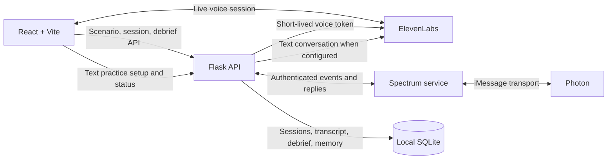

# Nice Try

<div align="center">

### Practice spotting the scam—before it happens for real.

An interactive social-engineering awareness trainer with **live browser voice calls**, **iMessage scenarios**, and a practical, transcript-based debrief.


</div>

---

## The experience

Choose a fictional situation, practice how you would respond, then review what helped and what to try next time. Nice Try is designed to make scam-awareness practice hands-on, repeatable, and judgment-free.

| Practice mode | What happens |
| --- | --- |
| **Phone Call** | Talk with a fictional AI caller in your browser. Mute or hang up whenever you like. |
| **Text Message** | Run a fictional conversation through iMessage on your phone. Text `REVEAL` to finish and `STOP` to cancel. |
| **Debrief** | Review transcript evidence, protective actions, risky moments, scenario warning signs, and a safer response to practice. |

### Six scenarios

| Scenario | Practice recognizing |
| --- | --- |
| Campus IT | Urgent account warnings and requests for verification codes |
| Bank Alert | Fraud claims designed to rush you into action |
| Gift Card Emergency | Irreversible payment requests |
| Family Emergency | Emotional pressure and demands for secrecy |
| Package Delivery Problem | Delivery-related claims and requests to act through an untrusted prompt |
| Job Offer Scam | Suspicious offers and requests for upfront payment |

All scenarios are fictional. The debrief is currently rule-based: it uses transcript evidence to identify actions and includes warning signs configured for the selected scenario. Scenario warning signs are educational context; they are not a claim that every tactic appeared in your conversation.

## How it fits together



- **React + Vite** provides mode selection, scenarios, practice, transcripts, and results.
- **Flask** serves scenarios and session/debrief APIs, and keeps voice credentials out of browser code.
- **ElevenLabs** powers browser voice practice and, when configured, text-agent conversations.
- **Spectrum + Photon** handle the iMessage transport.
- **SQLite** stores iMessage sessions and privacy-conscious participant memory locally.

## Twilio SMS training code

The app can send a fictional six-digit training code to the participant before the live call starts. Copy the placeholders from `backend/.env.example` to `backend/.env` and add the real Twilio values there, not in frontend code. The required variables are:

- `TWILIO_ACCOUNT_SID`
- `TWILIO_AUTH_TOKEN`
- `TWILIO_FROM_NUMBER`

The flow is simple:
1. The participant enters their own phone number and checks the consent box.
2. Flask validates the number, requires consent, and rate limits one code request per number per 30 seconds.
3. Flask creates a random six-digit fictional code, stores it by session id, and sends the SMS.
4. The client only sends the generated session id back to Flask and ElevenLabs receives the same value as the dynamic variable named `training_code`.
5. The debrief checks the transcript to see whether the participant repeated the fictional code.

Twilio trial accounts only send to verified numbers. Use a fictional code, never a real verification code, and keep all safety rules in place. The SMS body says this is a fictional training code, not a real code, and includes "Reply STOP to opt out". The code is never used for real account sign in, passwords, payment, or account verification.

## Running locally
## Get started

### Requirements

- Python 3 and Node.js with npm
- An internet connection for the hosted voice and messaging services
- For **Phone Call**: an ElevenLabs API key and configured agent IDs
- For **Text Message**: a Photon Spectrum project and an iMessage-connected line

### 1. Install dependencies

Run from the repository root:

```bash
python3 -m venv .venv
source .venv/bin/activate
pip install -r backend/requirements.txt

cd frontend
npm install
cd ..
```

Create the backend environment file:

```bash
cp backend/.env.example backend/.env
```

### 2. Configure the services you want to demo

#### Phone Call mode

Add an ElevenLabs API key and agent IDs to `backend/.env`. The sample environment file includes Campus IT, Bank Alert, and Gift Card. To enable the other scenarios for voice, also define:

```dotenv
ELEVENLABS_AGENT_ID_FAMILY_EMERGENCY=your_family_emergency_agent_id
ELEVENLABS_AGENT_ID_PACKAGE_DELIVERY=your_package_delivery_agent_id
ELEVENLABS_AGENT_ID_JOB_OFFER=your_job_offer_agent_id
```

Agent configuration and prompt guidance are in [AGENT_PROMPT.txt](AGENT_PROMPT.txt). Store real credentials only in local environment files; never put secrets in frontend code or variables prefixed with `VITE_`.

#### Text Message mode

Follow [IMESSAGE_SETUP.md](IMESSAGE_SETUP.md) for Photon setup, the shared service token, environment variables, build steps, and demo instructions. In brief, configure `backend/.env` with `NICE_TRY_INTERNAL_TOKEN`, `MEMORY_HASH_SECRET`, and `SPECTRUM_SERVICE_URL`; configure `spectrum-service/.env` with Photon project credentials and the Flask URL. The Spectrum bridge reads the internal token from the backend environment. Keep its value aligned with the setup guide.

The iMessage form uses a first name and a real phone number to set up delivery, and asks the participant to confirm they own the number or have permission to use it. The simulated conversation itself should use fictional details.

### 3. Start the app

Start Flask in one terminal:

```bash
cd backend
../.venv/bin/python app.py
```

Start the frontend in another terminal:

```bash
cd frontend
npm run dev
```

Open the local URL printed by Vite—normally [http://localhost:5173](http://localhost:5173). The frontend proxies `/api` requests to Flask on `127.0.0.1:5000`.

For **Text Message** practice, start the Spectrum service in a third terminal:

```bash
cd spectrum-service
npm install
npm run dev
```

The bridge listens on port `5051` by default. Confirm Flask is running at [http://127.0.0.1:5000/api/health](http://127.0.0.1:5000/api/health).

## Try a practice session

1. Choose **Text Message** or **Phone Call**, then select a scenario.
2. Follow the on-screen safety instructions. For a browser call, allow microphone access; for iMessage, complete the consent form and text `START` to the displayed number.
3. Respond as you would in real life. You can hang up from a call or text `STOP` to cancel.
4. For iMessage, text `REVEAL` to end the conversation and request your analysis. Calls move to the debrief when you hang up.
5. Review the shared results page and choose **Back to scenarios** to practice another situation.

## Safety & privacy

Nice Try is a training prototype, not a real bank, university, delivery company, employer, or emergency service.

- Use fictional information during practice. Never share passwords, account details, payment information, or real verification codes with a simulated caller.
- Text mode requires a real phone number for message delivery. Use only your own number or one you have permission to use.
- Keep service credentials in ignored `.env` files. Photon credentials belong in the Spectrum service—not in the browser.
- Local iMessage session data, transcripts, debriefs, and participant memory are stored in `backend/data/nice_try.db`. Phone numbers are represented in memory records by an HMAC hash, with the last four digits stored separately. The prototype has no automatic retention or deletion workflow; remove local data deliberately when it is no longer needed.
- Third-party services have their own processing and retention settings. Review and configure those settings in ElevenLabs and Photon before using the app with participants.

## Build & test

Build and type-check the frontend:

```bash
cd frontend
npm run build
```

Build the Spectrum service:

```bash
cd spectrum-service
npm run build
```

Run the Flask tests:

```bash
cd backend
../.venv/bin/python -m unittest discover -s tests -v
```

The Flask health and scenario endpoints can run locally without ElevenLabs credentials. Voice sessions require valid credentials and agents; iMessage sessions require the Photon/Spectrum configuration.

## Project map

```text
.
├── backend/
│   ├── app.py                 # Flask app and API registration
│   ├── routes/                # Scenarios, voice sessions, debrief, iMessage
│   ├── services/              # Agents, debrief, scenarios, session memory
│   ├── scenarios/             # Six fictional scenario definitions
│   └── tests/                 # Flask route and debrief tests
├── frontend/
│   └── src/                   # React screens, components, hooks, API client
├── spectrum-service/
│   └── src/server.ts          # Photon/Spectrum iMessage bridge
├── AGENT_PROMPT.txt          # Voice-agent prompt and configuration notes
└── IMESSAGE_SETUP.md         # Detailed Photon and iMessage setup
```

## Built for HackNC 2026

Nice Try turns scam awareness into a skill you can rehearse: **pause, question the pressure, verify independently, and choose a safer next step.**

## AI Use
We used AI for structuring, assistance with integration of tools, optimizing, and debugging.